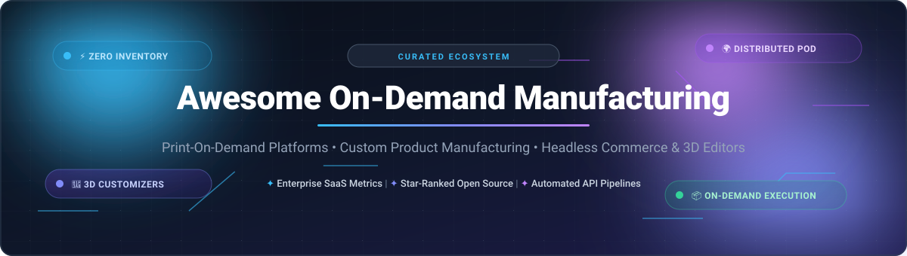

  

# 🏭 Awesome On-Demand Manufacturing & Print-On-Demand (POD)

  
  
  
  
  
  

> 🚀 **A curated directory of top SaaS on-demand manufacturing platforms, print-on-demand (POD) fulfillment networks, custom merchandise engines, headless ecommerce frameworks, and open-source product configurator repositories.**

---

## 📑 Table of Contents

- [🌐 Sector Overview & Market Dynamics](#-sector-overview--market-dynamics)
- [🏢 SaaS & Hosted On-Demand Manufacturing Platforms](#-saas--hosted-on-demand-manufacturing-platforms)
- [💻 Open-Source GitHub Projects (Ranked by Stars)](#-open-source-github-projects-ranked-by-stars)
  - [⚡ Top Open-Source Frameworks & Configurator Toolkits](#-top-open-source-frameworks--configurator-toolkits)
  - [🛠️ Architectural Categorization & Deep Dive](#-architectural-categorization--deep-dive)
- [🤝 How to Contribute](#-how-to-contribute)
- [💖 Support & Sponsorship](#-support--sponsorship)
- [📈 Star History](#-star-history)
- [⚠️ Disclaimer & Compliance](#️-disclaimer--compliance)

---

## 🌐 Sector Overview & Market Dynamics

The global print-on-demand and on-demand manufacturing market is valued at approximately **$13 billion to $16 billion as of 2025–2026 and is projected to exceed $46 billion to $57 billion by 2032**, expanding at a rapid compound annual growth rate (CAGR) of **23% to 25%**. 

The sector exhibits **moderate fragmentation with aggressive winner-take-most dynamics at the centralized fulfillment and supply chain layer**: category leaders like **Shopify** (powering platform commerce), **Printful**, and **Printify** (merging to establish dominant global liquidity and multi-facility networks), and **Gelato** (scaling localized decentralized production across 30+ countries) command the lion's share of high-volume merchant volume. In contrast, mid-tier specialized providers differentiate through niche embroidery techniques, ultra-fast turnarounds, or private-label custom branding.

---

## 🏢 SaaS & Hosted On-Demand Manufacturing Platforms

Below is a detailed comparison of top commercial on-demand manufacturing and print-on-demand fulfillment platforms, sorted in descending order by company enterprise scale (market capitalization, latest corporate valuation, or annual revenue).

| 🏢 Provider | 📊 Valuation / Scale | 💰 Pricing (Starting Paid Tiers) | 🎁 Free Tier Limit / Trial Parameters | 🌟 Key Focus & Highlights |
|:---|:---|:---|:---|:---|
| **[Shopify Make](https://www.shopify.com/)** | **~$105B+ Market Cap** (NYSE: SHOP; $11.5B+ annual rev) | **$5/mo** (Shopify Starter) or **$39/mo** (Basic Plan billed monthly; $29/mo annually) | **3-Day Free Trial** (no credit card required; then $1/mo for first 3 months; full app store POD integration) | Global commerce engine connecting directly to Printful, Printify, and Gelato apps for automated on-demand order processing. |
| **[Printful](https://www.printful.com/)** | **~$1.0B+ Valuation** (Unicorn status; $130M Bregal Sagemount round) | **$24.99/mo** (Printful Growth; free if yearly store sales reach $12,000) | **$0/mo Free Forever Plan** (Unlimited connected stores + 10 Quick Stores, unlimited product designs, pay base product costs upon order) | Vertically integrated in-house production facilities with 3-step automated quality checks and 450+ custom catalog items. |
| **[Gelato](https://www.gelato.com/)** | **~$1.05B Valuation** (Series D unicorn status; ~$50M–$100M revenue) | **$24.99/mo** (or $19.99/mo billed annually for Gelato+) | **$0/mo Free Forever Plan** (Up to 2 connected stores, 2 account users, access to standard design editor and local production) | Decentralized global network of 140+ local production partners across 32 countries; 87% of items produced in recipient country. |
| **[Printify](https://printify.com/)** | **~$300M–$500M Est. Valuation** ($54M VC raised; $100M+ GMV scale) | **$39.00/mo** (or $24.99/mo billed annually for Printify Premium with up to 20% product discounts) | **$0/mo Free Forever Plan** (Up to 5 stores per account, unlimited product designs, standard wholesale pricing across catalog) | Open print provider marketplace network spanning 140+ facilities in 209 countries with massive selection of 1,300+ blank goods. |
| **[SPOD](https://www.spod.com/)** | **~$100M+ Parent Scale** (Wholly-owned subsidiary of Spreadshirt / Spreadgroup) | **$0/mo (No Monthly Subscription)**; paid exclusively per order via unit wholesale pricing | **$0/mo 100% Free Access** (All features included: 200+ product catalog, RESTful API, mockups; 0 monthly fees for all merchants) | Powered by Spreadshirt's 20-year production backbone; 95% of orders printed and dispatched in under 48 hours with OEKO-TEX certified inks. |
| **[Gooten](https://www.gooten.com/)** | **~$50M–$100M Acquisition Scale** (Acquired by Taylor Corp; $36M funding) | **$0/mo Standard Platform**; custom contracted enterprise tiers for high-volume merchants | **$0/mo 100% Free Access** (No store connection limits, no product upload limits, pay only unit manufacturing + shipping costs) | Smart order routing engine with 40+ global fulfillment partners and 99.9% print accuracy designed for scaling Shopify brands. |
| **[Scalable Press](https://scalablepress.com/)** | **~$15M–$25M Est. Annual Revenue** (Venture-backed production network) | **$0/mo (No Subscription Fee)**; unit-based cost depending on garment type, print method, and quantity | **$0/mo 100% Free Access** (Full access to 4 proprietary manufacturing centers, automated API, white-label shipping slips) | High-throughput in-house direct-to-garment (DTG), screen printing, and embroidery operations with automated developer REST APIs. |
| **[Apliiq](https://www.apliiq.com/)** | **~$3.5M–$7.3M Est. Annual Revenue** (Bootstrapped private label leader) | **$29.99/mo** (Apliiq VIP Plan providing a flat 20% discount on all dropship garments and services) | **$0/mo Free Forever Plan** (Unlimited dropshipping product generation, standard base manufacturing rates; optional $10/mo warehousing storage) | Premium apparel specialization: custom woven brand labels, neck prints, embroidered patches, and luxury streetwear finishing. |
| **[Teelaunch](https://teelaunch.com/)** | **~$2.8M–$3.5M Est. Annual Revenue** (Bootstrapped POD pioneer) | **$0/mo (No Subscription Plans)**; revenue generated exclusively via wholesale base unit costs | **$0/mo 100% Free Access** (Full catalog access, 3D design editor with layer constraints, automated Shopify/Etsy sync) | Turnkey automated fulfillment app across apparel, laser-etched tumblers, and home décor with streamlined multi-channel sync. |
| **[CustomCat](https://www.customcat.com/)** | **~$1.2M–$5M Est. Annual Software Rev** (Detroit manufacturing facility) | **$30.00/mo** (or $25.00/mo billed annually for CustomCat PRO with 20%–40% wholesale catalog discounts) | **$0/mo Free Lite Plan** (Zero monthly fees, full product catalog access at standard wholesale base prices, multi-store support) | Industrial-scale Detroit production using proprietary DigiSoft Ink technology offering durable, high-res graphic prints. |

---

## 💻 Open-Source GitHub Projects (Ranked by Stars)

On-demand manufacturing is a domain where software cannot replace physical factory floors, textile machinery, or carrier shipping contracts. However, open-source projects provide the **storefront foundation, headless commerce APIs, 3D product visualizers, and batch mockup generation automation** that connect merchants to commercial fulfillment backends.

Below are the leading open-source repositories driving custom manufacturing architectures, **sorted in descending order by GitHub stargazers count**.

### ⚡ Top Open-Source Frameworks & Configurator Toolkits

| 📦 Repository | ⭐ GitHub_Stars | 🪪 License | 🛠️ Primary Tech Stack | 📌 Primary Role in On-Demand Manufacturing |
|:---|:---|:---|:---|:---|
| **[medusajs/medusa](https://github.com/medusajs/medusa)** |  | MIT | Node.js, TypeScript, PostgreSQL | Composable, headless digital commerce backend ideal for custom POD workflows and custom pricing logic. |
| **[bagisto/bagisto](https://github.com/bagisto/bagisto)** |  | MIT | PHP, Laravel, Vue.js | Modular ecommerce platform with customizable product options, attributes, and vendor management extensions. |
| **[saleor/saleor](https://github.com/saleor/saleor)** |  | BSD-3-Clause | Python, Django, GraphQL, React | GraphQL-first headless commerce engine allowing granular custom storefronts and POD webhooks. |
| **[spree/spree](https://github.com/spree/spree)** |  | BSD-3-Clause | Ruby on Rails, Turbo, Stimulus | Battle-tested, extensible multi-storefront commerce platform easily integrated with on-demand fulfillment endpoints. |
| **[woocommerce/woocommerce](https://github.com/woocommerce/woocommerce)** |  | GPL-3.0 | PHP, WordPress, React | The world's most widely deployed open-source store framework; native free plugins for Printful, Printify, and Gooten. |
| **[solidusio/solidus](https://github.com/solidusio/solidus)** |  | BSD-3-Clause | Ruby on Rails | Enterprise-grade customizable commerce core for complex inventory routing and multi-vendor on-demand production. |
| **[shopware/shopware](https://github.com/shopware/shopware)** |  | MIT | PHP, Symfony, Vue.js | Modern API-first commerce platform with rule builder and custom flow automation for on-demand order dispatch. |
| **[CTDave001/automated_mockups](https://github.com/CTDave001/automated_mockups)** |  | MIT | Python, Pillow | Batch automated placement of artwork onto apparel and mug templates with smart displacement mapping. |
| **[vihanrs/t-shirt-designer-webapp](https://github.com/vihanrs/t-shirt-designer-webapp)** |  | MIT | React, Three.js, Canvas | Interactive 3D garment customizer with 360-degree rotation, dual-sided printing, and live asset placement. |
| **[AkarshanGupta/TShirt-Designer](https://github.com/AkarshanGupta/TShirt-Designer)** |  | MIT | React, Three.js, TailwindCSS | Web-based 3D product customizer with dynamic color picking, decal uploading, and responsive UI controls. |
| **[Niraj-Hitpump/PrintO](https://github.com/Niraj-Hitpump/PrintO)** |  | ISC | React, Fabric.js, Node.js | Full-stack MERN product customizer application enabling drag-and-drop textile personalization and order carting. |
| **[NoorAlisha22/GZ-gitlab](https://github.com/NoorAlisha22/GZ-gitlab)** |  | MIT | React, Three.js | Frontend demonstration of an interactive 3D t-shirt store with height/weight/build sliders and live texture mapping. |

---

### 🛠️ Architectural Categorization & Deep Dive

#### 1. Self-Hosted Storefront Platforms (Direct POD Integrations)
- **[WooCommerce](https://github.com/woocommerce/woocommerce)**: The most practical and ubiquitous foundation for self-hosted on-demand manufacturing. Printful, Printify, and Gooten maintain official, free WordPress plugins providing bidirectional order syncing, mockup imports, and real-time carrier tracking.
- **[Medusa](https://github.com/medusajs/medusa)** & **[Saleor](https://github.com/saleor/saleor)**: Composable headless commerce backends built with TypeScript and Python GraphQL respectively. Ideal for brands requiring custom Next.js frontends, bespoke 3D design wizards, and custom REST webhook dispatches to POD fulfillment suppliers.
- **[Bagisto](https://github.com/bagisto/bagisto)** & **[Shopware](https://github.com/shopware/shopware)**: Robust European and global commerce systems featuring comprehensive multi-vendor architectures, product configurators, and rule-based workflow automations.

#### 2. Interactive 3D Product Customizers & Canvas Editors
- **[vihanrs/t-shirt-designer-webapp](https://github.com/vihanrs/t-shirt-designer-webapp)** & **[AkarshanGupta/TShirt-Designer](https://github.com/AkarshanGupta/TShirt-Designer)**: Demonstrate interactive Three.js 3D mesh rendering where customers inspect graphics wrapped around apparel geometry before purchasing.
- **[Niraj-Hitpump/PrintO](https://github.com/Niraj-Hitpump/PrintO)**: Reference implementation utilizing HTML5 canvas (Fabric.js) for 2D layer ordering, text scaling, rotation, and graphic alignment on t-shirts.

#### 3. Automation, Image Processing & Batch Generators
- **[CTDave001/automated_mockups](https://github.com/CTDave001/automated_mockups)**: Python Pillow automation pipeline enabling merchants with thousands of graphic designs to automatically generate photo-realistic mockups across diverse apparel templates in batch.

---

## 🤝 How to Contribute

Contributions are welcome! Follow these simple steps:

1. 🍴 **Fork the repository**.
2. 🌿 **Create a new branch** (`git checkout -b feature/add-pod-tool`).
3. 📝 **Add your entry** adhering to the markdown table format (including exact pricing, specific free tier limits, Stars_Badges linking to stargazers, and architectural notes).
4. 🚀 **Submit a Pull Request** with a concise description of the addition.

---

## 💖 Support & Sponsorship

Thank you for visiting **Awesome On-Demand Manufacturing**! If this curated repository has helped you evaluate print-on-demand vendors, architect custom apparel platforms, or discover open-source customizer tools:

- ⭐ **Star this repository** to improve discoverability for creators, merchants, and developers.
- 🍴 **Fork and share** the project with ecommerce founders and tech communities.
- ☕ **Support continuous maintenance**: Sponsor updates via the **[GitHub Sponsors Dashboard](https://github.com/sponsors/ishandutta2007)**.

---

## 📈 Star History

---

## ⚠️ Disclaimer & Compliance

- 🏭 **Software vs. Physical Infrastructure**: Open-source tools provide the customizer frontend, checkout logic, and order routing APIs. However, software alone cannot replicate industrial DTG printers, embroidery machines, sewing facilities, or global carrier logistics. Turnkey custom manufacturing requires partnering with commercial providers such as Printful, Printify, or Gelato.
- 🎨 **Intellectual Property & Trademarks**: Operators running custom on-demand printing platforms must enforce DMCA copyright policies and trademark compliance checks to prevent unauthorized reproduction of copyrighted imagery.
- 📜 **Licensing**: Verify software licenses before commercial deployment (e.g., MIT, BSD-3-Clause, GPL-3.0).

---

  Curated with ❤️ by <a href="https://github.com/ishandutta2007">Ishan Dutta</a> and the global open-source commerce community.

